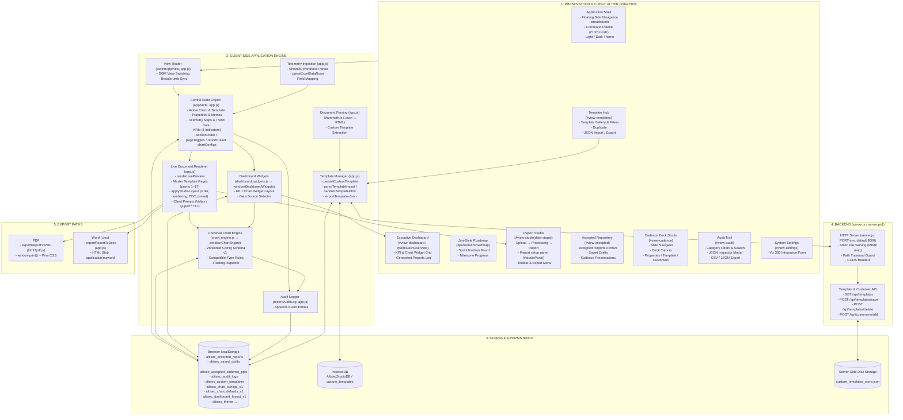
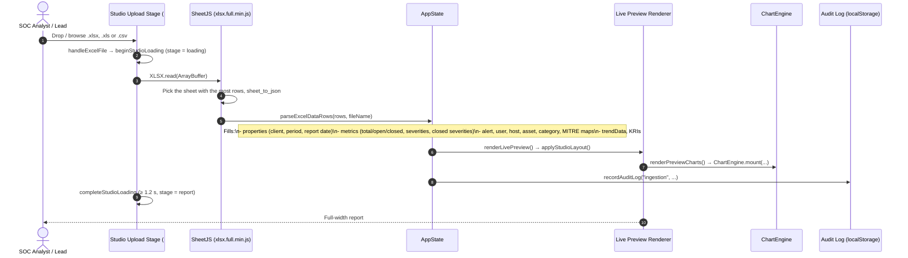
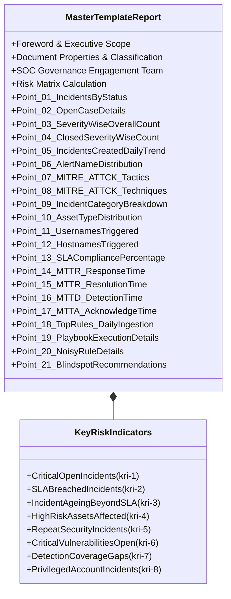
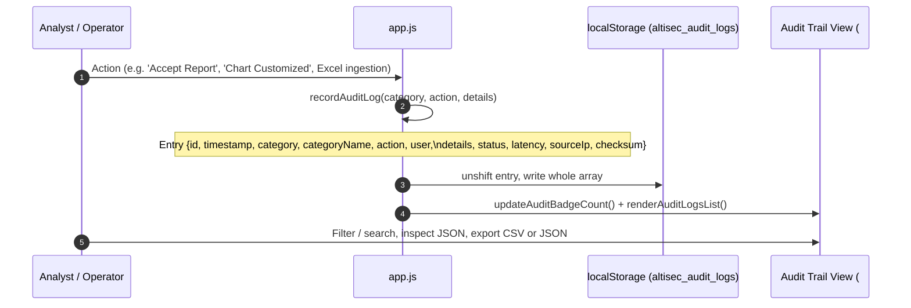

# AltiSec SOC Report Automation Platform
## System Architecture Blueprint & Technical Reporting Specification

> [!IMPORTANT]
> **Document Purpose**: This technical specification defines the end-to-end system architecture, data ingestion pipeline, Report Studio flow, chart and dashboard engines, template management, and reporting framework of the **AltiSec Security Operations Center (SOC) Report Automation Platform**.

---

## 1. Executive System Overview

The **AltiSec SOC Report Automation Platform** is a cybersecurity reporting suite that aggregates, normalizes and summarizes security event telemetry exported from SIEM, EDR and perimeter firewall tooling.

The platform bridges Tier-1/2 SOC engineering workflows and executive governance by turning exported incident data into standardized **Weekly Executive Reports**, **Monthly Cadence Decks** and a **Jira-Style Roadmap**, with minimal manual document assembly.

```
+----------------------------------------------------------------------------------------------------+
|                                    ALTISEC SOC AUTOMATION PLATFORM                                 |
+--------------------------+------------------------------+------------------------------------------+
| Report Studio            | Charts & Dashboard           | Export                                   |
| - Upload → Process →     | - Universal Chart Engine     | - PDF download (html2pdf.js)             |
|   Review guided flow     | - Per-chart inspector        | - Print (browser print driver)           |
| - Excel (XLSX, XLS, CSV) | - Customizable widget grid   | - Word (.doc, HTML-based)                |
| - Section layout presets |                              | - Template JSON import / export          |
+--------------------------+------------------------------+------------------------------------------+
```

---

## 2. High-Level System Architecture Diagram

The application is a client-heavy Single-Page Application (SPA) with a central state object (`AppState`) and browser storage (`localStorage`, plus IndexedDB for custom templates). A small backend (`server.js`, or `server.ps1` as a fallback) serves the static files and persists custom templates and customers to an on-disk JSON file.



Script load order (`index.html`): `image_data.js` → `chart_engine.js` → `dashboard_widgets.js` → `app.js`. Stylesheets: `style.css`, then `theme-floating.css`.

---

## 3. Telemetry Ingestion & Data Normalization Pipeline

Telemetry is sourced from Excel workbooks (`.xlsx`, `.xls`, `.csv`), parsed in the browser via **SheetJS**, and mapped into `AppState` while Report Studio shows its processing stage.



A parse error calls `failStudioLoading`, which returns to the upload stage (or to the report if one was already loaded). The upload stage also offers three sample buttons (weekly, monthly, July), which load built-in sample figures through `fetchPresetExcelAndGenerateReport`, and a "skip" link that opens the template without data.

---

## 4. Report Studio (`#view-studio`)

### Guided flow
The current step is the `data-stage` attribute on `#view-studio`, set by `setStudioStage`:

| Stage | Shows | Entered by |
| :--- | :--- | :--- |
| `upload` | Dropzone, the active template (with a link to the Template Hub), sample buttons, skip link | Initial load, `showStudioUpload`, `resetAppStateToCleanTemplate`, or a failed first upload |
| `loading` | Processing card with the file name | `beginStudioLoading`; held for at least `STUDIO_MIN_LOADING_MS` (1200 ms) |
| `report` | Full-width A4 paper (`#a4DocumentPreview`) | `completeStudioLoading`, `skipStudioUpload`, or restoring a draft / accepted snapshot |

The earlier left control sidebar and its input forms were removed; the report now uses the full width, and setup lives in the floating panel below.

### Toolbar
"Report setup" panel toggle, undo / redo, page navigation, Edit / Preview mode (`setStudioMode`; Preview closes any open chart inspector), Save draft, and the Export menu: Accept report, Download PDF, Export Word (.doc), Print / save as PDF, and Save to archive.

### Report setup panel (`#studioPanel`)
A floating panel styled like the chart inspector; `Esc` closes it (the chart inspector handles `Esc` itself while open).

| Tab | Contents |
| :--- | :--- |
| **Sections** | Checkbox list of page units with drag or arrow reordering (required units keep a ticked, disabled checkbox; the cover is pinned first and cannot move), a reset action, and the presentation preset grid |
| **Data** | Current file name, upload new data (returns to the upload stage), template selector (`#headerTemplateSelect`) |
| **KRIs** | Enable / disable checkboxes for the 8 KRIs (values are edited inline on the page) |
| **Templates** | Custom template creator and template library (`openCreateTemplateStudio` opens the panel on this tab) |

Report properties, counts, highlights and MTTx / SLA values are edited inline on the rendered pages, not in the panel.

### Section layout & presets
- `STUDIO_SECTIONS` lists 15 page units in default order: cover (pinned first), foreword, risk calculation, table of contents, document property & SOC team, confidentiality clause, then points §1–2, §3–4, §5, §6–9, §10–11, §12–13, §14–15, §16–17, and the governance team matrix. Some units are required; units with `parts` (e.g. MTTR response / resolution) can hide each part separately.
- Layout state lives in `AppState.sectionOrder`, `AppState.pageToggles` and `AppState.reportPreset`, and travels with drafts and accepted snapshots.
- `applyStudioLayout` applies the preset class, removes hidden units, reorders pages, renumbers page badges (`.pg-num`) and rewrites the table of contents. Order and preset changes move existing nodes; visibility changes re-render the preview.
- `REPORT_PRESETS` are presentation-only classes on `#a4DocumentPreview` (`rp-standard`, `rp-executive`, `rp-socops`, `rp-minimal`, `rp-dark`) styled in `theme-floating.css`. They affect screen, print and PDF output; the Word export uses its own stylesheet.
- **Undo / redo**: one stack (`studioHistory`) records layout changes and report chart edits; undoing a chart entry calls `ChartEngine.undo()`. Toolbar buttons and `Ctrl+Z` / `Ctrl+Y` (outside text fields) drive it.

---

## 5. Universal Chart Engine (`chart_engine.js`)

Every Chart.js chart in the app — the report preview sections (`renderPreviewCharts` in `app.js`) and the dashboard widgets — is registered with `window.ChartEngine`, which owns the config schema, the renderer and a single floating inspector.

```mermaid
flowchart LR
    subgraph Register["1. REGISTRATION"]
        Mount["ChartEngine.mount(id, spec)\nspec: name, surface, store,\ndefaults, getData(datasetId)"]
    end

    subgraph Config["2. EFFECTIVE CONFIG (merge, left → right)"]
        Base["BASE schema (v: 1)"]
        Defaults["spec.defaults"]
        Saved["Saved default\n(altisec_chart_defaults_v1[id])"]
        Override["Override\nstore 'report' → AppState.chartConfigs[id]\nstore 'local' → altisec_chart_configs_v1[id]"]
    end

    subgraph Render["3. RENDER"]
        Data["normalizeData(getData())\n(copied, never mutated)"]
        Compat["whyIncompatible(type, shape)\n→ fall back to first compatible type"]
        Transform["sort / top-N / 'Other'"]
        Out["Chart.js canvas\nor HTML view (KPI tiles, data table)"]
    end

    subgraph Edit["4. INSPECTOR"]
        Insp["Tabs: Chart / Data / Style\nApply · Cancel · Reset\nSave as default · Undo / Redo"]
    end

    Mount --> Base --> Defaults --> Saved --> Override --> Data --> Compat --> Transform --> Out
    Out --> Insp
    Insp -->|"commit: store diff vs baseline"| Override
```



### Config schema (version 1)
`SCHEMA_VERSION = 1`. Every stored config is passed through `sanitize()`, which keeps only known fields with valid values (legacy, malformed or future configs are tolerated):

| Field | Values |
| :--- | :--- |
| `type` | one of the 13 chart types below |
| `title`, `subtitle`, `xTitle`, `yTitle`, `unit` | strings (max 160 chars) |
| `legend` | `{ show: boolean, position: top \| right \| bottom \| left }` |
| `dataLabels`, `tooltip`, `grid`, `axis`, `other`, `colorByPoint` | booleans |
| `decimals` | integer −1 (auto) to 4 |
| `palette` | `source`, `soc`, `severity`, `corporate`, `ocean`, `violet`, `emerald`, `mono` |
| `colors` | per-label `#rrggbb` overrides (max 60) |
| `sort` | `none`, `asc`, `desc` |
| `topN` | integer 0–50 (0 = all) |
| `dataset` | dataset id (dashboard widgets) |

Only the difference from the baseline (`defaults` + saved default) is stored (`diff()`), so a later "Save as default" still flows through to charts that were not customized.

### Compatible-type rules
Data is classified by shape: `cat` (one series), `time` (one series over periods) or `multi` (two or more series). Each type declares the shapes it accepts:

| Types | Accepted shapes |
| :--- | :--- |
| Pie, Doughnut, Polar area, KPI tiles | `cat` |
| Column (`bar`) | `cat`, `time` |
| Horizontal bar | `cat`, `multi` |
| Grouped bar, Stacked bar, Stacked area | `multi` |
| Line, Area, Data table | `cat`, `time`, `multi` |
| Radar | `cat`, `multi` (needs ≥ 3 categories) |

Incompatible types are disabled in the inspector with the reason as a tooltip; a stored type that no longer fits the data falls back to the chart's default type or the first compatible one. Options that do not apply to the current type (e.g. gridlines on a pie, sort on time series) are disabled the same way.

### Inspector and persistence
- **Inspector**: floating `aside.ce-inspector` dialog with Chart / Data / Style tabs, opened from each chart's **Edit chart** button. Edits are a draft until **Apply**; **Cancel** or `Esc` discards. `Ctrl+Z` / `Ctrl+Y` inside the inspector undo and redo applied changes (history of 100).
- **Report charts** (`store: 'report'`) keep overrides in `AppState.chartConfigs`, which is included in saved drafts and accepted-report snapshots (`snapshotAppState`) and restored by `restoreSnapshotExtras`. Each applied change is also pushed onto the Report Studio undo stack.
- **Dashboard charts** (`store: 'local'`) keep overrides in `localStorage` key `altisec_chart_configs_v1`.
- **Save as default** writes per chart id to `altisec_chart_defaults_v1`, applied in every report.
- Each applied change is logged as `Chart Customized` in the audit trail.
- A built-in `selfCheck()` (`console.assert`) verifies that transforms never mutate source data and that `sanitize()` rejects junk.

---

## 6. Customizable Executive Dashboard (`dashboard_widgets.js`)

The Overview pane of the dashboard (`#dashWidgetRoot`) is a 12-column widget grid rendered by `window.DashboardWidgets`.

- **Widgets**: 9 KPI cards (total, open, closed, critical + high, SLA compliance, MTTR, MTTD, MTTA, daily ingestion) and chart widgets over 12 datasets (daily trend, severity, severity by status, incident status, alert rules, MITRE tactics, MITRE techniques, categories, asset types, usernames, hostnames, KRIs).
- **KPI styles**: simple, with progress bar, or with sparkline (history across the client's accepted reports); deltas compare with the previous accepted report for the same client.
- **Charts** mount through `ChartEngine` with ids `dash-<widgetId>` and `store: 'local'`, so they share the report inspector.
- **Data source**: the current working report (`AppState`) or any accepted report that has a `stateSnapshot`; the choice is stored in `altisec_dashboard_source`.
- **Customize mode**: add, hide/show, resize (KPI widths 2/3/4/6, chart widths 4/6/8/12 columns), reorder (drag or arrow buttons), undo/redo, and **Reset** (restores the default layout and clears `dash-` chart overrides via `ChartEngine.resetLocal`).
- **Layout persistence**: `localStorage` key `altisec_dashboard_layout_v1` holding `{ v: 1, savedAt, widgets }`; each widget passes through `sanitizeWidget()` on load.

---

## 7. Template Hub, Cadence Deck Studio & Accepted Repository

### Template Hub (`#view-templates`)
- **Gallery** (`#unifiedTemplatesGrid`, rendered by `renderTemplatesHubView`): cards for built-in and custom templates, with All / Weekly / Monthly / Custom filter chips (`#templateHubFilters`) and search.
- **Duplicate** (`duplicateTemplateFromHub`): a custom template copies its content; a built-in is copied as a reference (`baseTemplate`) to its layout, which `renderLivePreview` honours.
- **Export** (`exportTemplatesJson`): one template from its card, or every custom template from the header button, as `{ format: "altisec-templates", version: 1, exportedAt, templates }`. Built-ins export as a `baseTemplate` reference.
- **Import** (`importTemplatesFromFile` → `parseTemplateImport`): accepts the export format, a bare array or a single object; files over 20 MB are refused, at most 50 templates are read, each needs a name and gets a new id. Template HTML passes through `sanitizeTemplateHtml`, which removes `script`, `iframe`, `object`, `embed`, `link`, `meta`, `base`, `form`, `style` and frame elements, every `on*` attribute, and `javascript:` / `vbscript:` / `data:text` URLs. A self-check (`console.assert`) covers the sanitizer and parser.
- **Persistence** (`persistCustomTemplate`): every created, duplicated or imported template is written to IndexedDB (`AltisecStudioDB` / `custom_templates`), the server (`POST /api/templates/save`) and `localStorage` (`altisec_custom_templates`). Duplicate, import and export are recorded in the audit trail.

### Cadence Deck Studio (`#view-cadence`)
- **Slide navigator** (`#cadenceSlideNav`): thumbnails with go-to, drag or up/down reordering (`moveCadenceSlide`), duplicate (`duplicateCadenceSlide`) and delete (`deleteCadenceSlide`); the toolbar has previous / next.
- **Deck canvas** (`#cadenceSlideDisplay`) shows the current slide.
- **Inspector tabs**: Properties (slide data form), Template (`.pptx` dropzone) and Customers.
- Save Draft and Export PPTX store the deck as a slide snapshot in `altisec_accepted_cadence_ppts`; no `.pptx` file is generated (see section 10).

### Accepted Repository (`#view-accepted`)
- Three tabs: accepted reports (`renderAcceptedReportsList`: Restore, PDF), cadence decks (`renderAcceptedCadencePpts`) and saved drafts (`renderSavedDraftsList`: Resume, Delete), each with a count badge. The header's clear button (`#btnClearAcceptedRepo`) empties the accepted reports list after a confirm.
- Tables use the shared design tokens, HTML-escape every stored value (`escapeAuditHtml`), and show an empty state (`repoEmptyState`) when a list has no entries. The Audit Trail view was restyled the same way.

---

## 8. Application Shell, Design Tokens & Command Palette

- **Design tokens** (`theme-floating.css`, loaded after `style.css`): defines surface, ink, accent, radius, shadow and easing tokens on `:root` (overridden under `body.light-theme`) and bridges them onto the legacy `--bg-*`, `--text-*` and `--border-color` variables used by `style.css` and inline styles. It also styles the shell, shared components, command palette, chart inspector, Studio stages and setup panel, report presets, dashboard grid, motion and print rules. Light-theme overrides in `style.css` exclude the report paper and cadence slides, so exports look the same in either theme.
- **Command palette** (`openCommandPalette` in `app.js`): opened with `Ctrl+K` / `Cmd+K` or the header search button. It lists every module from `APP_MODULES` plus actions (toggle theme, collapse sidebar, customize dashboard, save report draft, export audit log as JSON), filtered as you type, with arrow-key / Enter / Esc navigation.
- **Theme and sidebar state** persist in `altisec_theme` and `altisec_sidebar_collapsed`.
- **System Settings** (`#view-settings`) holds only the Viz 360 integration form (endpoint URL, token, sync frequency). The Test / Save buttons currently only show a toast; no request is sent and nothing is persisted.

---

## 9. Detailed Report Architecture & The 21-Point Template Matrix

The reporting standard behind the platform is **`template-firstcheck-3` (Master Template Report)**, a 21-point operational and governance framework required by SOC clients (such as Tata Technologies, Voltas Limited, and Crompton Butterfly).

> [!NOTE]
> The live renderer implements points **1–17** plus the front matter and governance pages (see `STUDIO_SECTIONS`, section 4). Points **18–21** are part of the standard but have no rendered pages yet; daily ingestion volume appears only as a dashboard KPI.



### The 21 Key Reporting Points Breakdown

| Point # | Section Name | Target Telemetry Data | SOC Objective |
| :---: | :--- | :--- | :--- |
| **01** | **Incidents / Cases by Status** | Critical, High, Medium, Low split into New, In-Progress, and Resolved. | High-level triage velocity overview. |
| **02** | **Open Case Details** | Case ID, Name, Severity, Current State, Assigned Tier-2/3 Owner, Technical Remarks. | Visibility into ongoing investigations. |
| **03** | **Overall Severity Count** | Aggregated count across all incoming events by severity tier. | Threat landscape volume profiling. |
| **04** | **Closed Severity Count** | Count of successfully contained and closed security events. | SOC throughput and containment metric. |
| **05** | **Daily Incident Trend** | 7-day volume histogram (Mon–Sun) identifying peak operational days. | Shift planning & anomaly detection. |
| **06** | **Alert Names Distribution** | Frequency matrix of top SIEM detection rules triggering tickets. | Identification of top threat vectors. |
| **07** | **MITRE ATT&CK Tactics** | Observed Enterprise Tactics (e.g. TA0001 Initial Access, TA0002 Execution). | Kill-chain phase mapping. |
| **08** | **MITRE ATT&CK Techniques** | Specific observed techniques (e.g. T1059 PowerShell, T1566 Phishing). | Technical indicator identification. |
| **09** | **Incident / Case Category** | Taxonomy split: Malware, Lateral Movement, Policy Violation, Phishing. | Root-cause categorisation. |
| **10** | **Asset Type Distribution** | Target machine profiling (Workstations, Production Servers, Cloud Ingress). | Target surface vulnerability assessment. |
| **11** | **Triggered Usernames** | Top affected user accounts, service accounts, and administrators. | Compromised credential detection. |
| **12** | **Triggered Hostnames** | Top endpoint assets and server hosts generating alerts. | Repeated asset compromise detection. |
| **13** | **SLA Compliance Rate** | Mathematical percentage against target SLA ($\ge 95.0\%$). | Contractual adherence & governance. |
| **14** | **MTTR Response Time** | Mean Time to Respond (Target $< 15$ mins). | Tier-1 initial triage performance. |
| **15** | **MTTR Resolution Time** | Mean Time to Resolve / Contain (Target $< 4.0$ hrs). | Tier-2/3 investigation efficiency. |
| **16** | **MTTD (Detection Time)** | Mean Time to Detect from initial log generation to SIEM alert. | Sensor and detection latency health. |
| **17** | **MTTA (Acknowledge Time)** | Mean Time to Acknowledge ticket assignment. | Operational responsiveness metric. |
| **18** | **Daily Ingestion & Top Rules** *(not rendered)* | Telemetry ingestion volume (GB/day) and top 3 correlation rules. | Infrastructure bandwidth & SIEM health. |
| **19** | **Playbook Execution Details** *(not rendered)* | Automated response workflows triggered (e.g. Host Isolation, Password Reset). | SOAR automation effectiveness. |
| **20** | **Noisy Correlation Rules** *(not rendered)* | False-positive and high-frequency rules identified for exclusion/tuning. | SOC alert fatigue reduction. |
| **21** | **Blindspots & Actions** *(not rendered)* | Monitored perimeter gaps, unmonitored assets, and hardening recommendations. | Continuous posture improvement. |

---

## 10. Document Export Paths

All report exports read the rendered `#a4DocumentPreview`, so section order, hidden sections and the preset are already applied.

```mermaid
flowchart TD
    ReportState["AppState + rendered A4 preview (#a4DocumentPreview)"]

    subgraph PDFExport["A. PDF (Export menu → 'Download PDF')"]
        P1["exportReportToPDF(): saveCurrentReportToArchive(true)"]
        P2["Chart canvases → images, page cards prepared"]
        P3["html2pdf() → <Client>_SOC_Report_<timestamp>.pdf\n(falls back to window.print())"]
        P1 --> P2 --> P3
    end

    subgraph PrintExport["B. PRINT (Export menu → 'Print / save as PDF')"]
        R1["saveCurrentReportToArchive(true)"]
        R2["preparePrintCanvasImages()"]
        R3["window.print() with print CSS"]
        R1 --> R2 --> R3
    end

    subgraph DOCExport["C. WORD (Export menu → 'Export Word (.doc)')"]
        W1["exportReportToDocx(AppState)"]
        W2["Clone #a4DocumentPreview, canvases → images"]
        W3["Wrap HTML in a Word-compatible document"]
        W4["Blob type application/msword → <Client>_SOC_Report_<timestamp>.doc"]
        W1 --> W2 --> W3 --> W4
    end

    ReportState --> PDFExport
    ReportState --> PrintExport
    ReportState --> DOCExport
```



- **PDF / Print**: accepted-report "Export PDF" (`exportAcceptedReportPdf`) restores the snapshot and then triggers the Print / save as PDF action; the dashboard PDF button (`exportDashboardPdf`) also uses `window.print()`.
- **Word**: `exportReportToDocx` produces an HTML-based `.doc` file that Word opens; it is not OpenXML, and it uses its own stylesheet, so presets do not apply. `docx_exporter.js` (docx.js / OpenXML) remains in the folder but is **not loaded** by `index.html`. The older `window.pbiExportPdf` / `window.pbiExportDocx` wrappers have no callers.
- **Excel**: `pbiExportExcel` writes the Power BI-style data grid to `.xlsx` with SheetJS.
- **Cadence decks**: no `.pptx` file is generated. "Save Draft" and "Export PPTX" store a slide snapshot in `altisec_accepted_cadence_ppts`; the download actions only show a toast.

---

## 11. State Management & Audit Log



### Audit categories
| `category` | Display name |
| :--- | :--- |
| `report` | Report Generation |
| `cadence` | Cadence PPT |
| `ingestion` | Data Ingestion & Sync |
| `export` | Exports & Downloads |
| anything else | System Event |

The view has filter chips and a category dropdown for the first four, plus free-text search and sorting. When the log loads, entries saved under the retired `ml` category are dropped from `AppState.auditLogs`; this deletion is intended.

### Audit log limitations
- The log lives only in the browser's `localStorage` (`altisec_audit_logs`). Any user of that browser can edit or clear it (the view has a "Clear audit trail" action), and it is not shared across machines.
- It is **not tamper-proof**: `checksum`, `latency` and `sourceIp` are random placeholder values generated in `recordAuditLog`; no hash is computed. The audit UI's "SHA-256" labels do not reflect real hashing.
- Treat it as an activity history, not as compliance evidence.

### State & server safeguards
1. **Snapshots**: accepted reports and saved drafts store `snapshotAppState()` (all of `AppState` except the collections themselves), including telemetry maps, KRIs, `chartConfigs`, `sectionOrder`, `pageToggles` and `reportPreset`. Restoring one (`restoreSnapshotExtras`) opens Report Studio at the `report` stage.
2. **Session persistence**: unfinished work is recoverable from `altisec_saved_drafts`.
3. **Path traversal guard**: `server.js` rejects any resolved path outside the app folder (`!filePath.startsWith(PUBLIC_DIR)`). `server.ps1` does the same: it resolves the decoded path with `[System.IO.Path]::GetFullPath` and returns 403 unless it stays inside the app folder (case-insensitive compare). Windows' HTTP.sys also rejects `..` URLs before they reach the script.
4. **Imported templates** are sanitized before they can reach the live preview (section 7).

---

## 12. Technology Stack & Component Directory

| Subsystem | Technology / File | Purpose & Implementation Details |
| :--- | :--- | :--- |
| **Frontend** | **Vanilla JavaScript, no build step** | `app.js` (state, views, Report Studio, ingestion, rendering, templates, exports), loaded from `index.html`. |
| **Chart Engine** | **`chart_engine.js`** | `window.ChartEngine`: config schema v1, compatible-type rules, floating inspector, undo/redo. |
| **Dashboard** | **`dashboard_widgets.js`** | `window.DashboardWidgets`: KPI/chart widget grid, data source selector, layout persistence. |
| **Styles & Tokens** | **`style.css` + `theme-floating.css`** | Base styles plus the design-token layer, shell, Studio, inspector, report presets and dashboard grid styles. |
| **Embedded Assets** | **`image_data.js`** | Base64 images used in the rendered report. |
| **Charts** | **Chart.js (jsDelivr, unpinned version)** | Canvas charts drawn by the chart engine. |
| **Data Ingestion** | **SheetJS (xlsx.full.min.js v0.18.5)** | In-browser parsing of `.xlsx`, `.xls` and `.csv`; also `.xlsx` grid export. |
| **Document Parsing** | **Mammoth.js (v1.6.0)** | Client-side `.docx` → HTML for custom template creation. |
| **PDF** | **html2pdf.js 0.10.1 + browser print driver** | "Download PDF" via html2pdf.js; "Print" and fallbacks via `window.print()` and print CSS. |
| **Word Export** | **HTML-based `.doc` (`exportReportToDocx` in `app.js`)** | Word-compatible HTML blob; `docx_exporter.js` is not loaded. |
| **Icons & Typography** | **FontAwesome 6.4.0, Google Fonts Outfit / Plus Jakarta Sans** | Iconography and UI typography. |
| **Backend** | **Node.js HTTP server (`server.js`)** | Static files plus template/customer API; listens on `process.env.PORT`, default 8000. |
| **Fallback Server** | **PowerShell HTTP listener (`server.ps1`)** | Same static files and API for Windows machines without Node; `-Port` parameter, default 8000. |
| **Storage** | **localStorage, IndexedDB + `custom_templates_store.json`** | localStorage for reports, drafts, audit log, chart and dashboard settings; IndexedDB, localStorage and the server JSON file for custom templates; the JSON file also holds customers. |

---

> [!TIP]
> **Next Recommended Steps**:
> 1. To start a report, open **Report Studio** (`#view-studio`), drop an Excel/CSV export or pick a sample, then use **Report setup** to reorder sections or choose a preset.
> 2. To change a report chart, use **Edit chart** on any chart in the report.
> 3. To manage templates, open the **Template Hub** (`#view-templates`) to duplicate, import or export them.
> 4. To customize the dashboard, open the **Dashboard** (`#view-dashboard`) and choose **Customize**, or press `Ctrl+K` and run "Customize dashboard".
> 5. To review recorded activity or export it, visit the **Audit Trail** (`#view-audit`).
